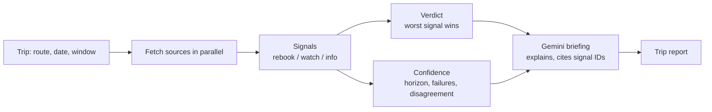

# Preflight Checks

A travel disruption desk for operations teams. Every upcoming employee flight gets one call (**Go**, **Watch**, or **Rebook**), a confidence level, the evidence behind it, and what to do next.

Built as a working prototype: live public data, a transparent rules engine, and an AI layer that explains the call without making it.

## The problem

When someone on the team is flying, an operations coordinator has to check the FAA status page, the weather at three airports, the aviation forecast, and their own gut feel for whether that route is usually a mess. Nobody does all of that for every trip, so disruptions get noticed when the traveler calls from the gate.

Preflight Checks does those checks for every trip on the roster and answers three questions: is there a real risk, what is it and where, and what should we do about it.

## What you see

**The roster** (home page). Every upcoming trip, checked live against FAA, NWS, and aviation forecasts as the page loads. The header counts how many trips need a look, and each row shows the verdict, confidence, and the main risk in one line. The roster is seeded with 10 travelers whose dates are relative to today (same day through two weeks out), so the demo always shows the full range of confidence levels.

**The trip report.** Open any trip, or check a new one from the form.

- The route drawn as a flight arc. Each airport is colored by its worst signal: green clear, amber watch, red rebook.
- The verdict and confidence, with a plain-English explanation of why confidence is high, medium, or low.
- An AI-written briefing and up to four recommended actions. Each action links to the evidence it relies on.
- Evidence cards grouped by departure, connection, and arrival airport, each with a link to the raw source.
- A "normal day on this route" comparison from BTS history: this route's disruption rate for the month versus the U.S. average.
- Nearby airports (for example LGA and EWR when flying from JFK) and whether they're clear of FAA programs right now.
- A log of every data check: what ran, what was skipped, and why.

Trips can include a connecting airport and a departure window (morning, afternoon, evening, or any time), since afternoon thunderstorms at a hub are often the real risk.

## Data sources

All free and public. Only Gemini needs a key, and it's free through Google AI Studio.

| Source | What it provides | Used when the trip is |
|---|---|---|
| [FAA NAS Status](https://nasstatus.faa.gov/) | Ground stops, ground delay programs, departure/arrival delays, closures | Today or tomorrow |
| [NWS API](https://www.weather.gov/documentation/services-web-api): hourly forecast | Thunderstorms, snow and ice, fog, and strong wind during the departure window | Within 7 days |
| [NWS API](https://www.weather.gov/documentation/services-web-api): active alerts | Warnings, watches, and advisories at each airport's exact location | Within 7 days |
| [AviationWeather.gov TAFs](https://aviationweather.gov/data/api/) | The airport forecasts pilots and dispatchers use: ceilings, visibility, gusts, storms | Within about 30 hours |
| [BTS On-Time Performance](https://www.transtats.bts.gov/) | Share of flights late 15+ minutes, cancelled, or diverted, by route and month | Always (the baseline) |
| [Google Gemini](https://ai.google.dev/) | Writes the trip briefing | Trip report only |

Each source only contributes when it is actually informative for the trip date. A ground delay at Boston right now says nothing about next Thursday, so FAA programs are ignored beyond tomorrow. The data checks panel shows which sources were skipped and why, so "no signal" never gets confused with "didn't look."

The BTS baseline is included in the repo as `data/baseline.json`: October to December 2025, about 1.76 million flights, 1,436 routes between the supported airports.

## How a verdict is made



1. **Collect.** Every finding becomes a *signal* with a level (`rebook`, `watch`, or `info`), a plain-language detail, and a link to the source.
2. **Verdict = the worst signal.** Any rebook-level signal makes the trip Rebook. Any watch-level signal makes it Watch. Otherwise Go.
   - **Rebook:** a ground stop or airport closure today, a ground delay program today averaging an hour or more, or an NWS *warning* that affects flying (winter storm, hurricane, severe thunderstorm, high wind, and similar) during the trip.
   - **Watch:** thunderstorms, snow or ice, fog, or strong wind forecast in the window; a TAF showing storms, low ceilings, poor visibility, or strong gusts; an NWS advisory or watch; any FAA program the day before travel; or, past the forecast range only, a route that is historically disruption-prone that month.
   - A forecast alone can never make a trip Rebook. Only official FAA programs and NWS warnings can.
3. **Confidence** comes from the data, never from the AI:
   - **High:** within 2 days, all live checks succeeded, sources agree.
   - **Medium:** 3 to 7 days out, one check failed, or the NWS forecast and the TAF disagree at the same airport.
   - **Low:** more than 7 days out (history only), part of the window is past the forecast, or two or more checks failed.
4. **Gemini explains.** It receives the trip, the verdict, the confidence reasons, and every signal with an ID. It writes a headline, a summary that compares the trip to the route's normal day, a confidence explanation, and recommended actions that must cite signal IDs.

**Guardrails on the AI**
- It cannot change the verdict or confidence. The headline is forced to lead with the rules' verdict.
- Citations to signal IDs that don't exist are dropped.
- Low temperature (0.2) and JSON-only output.
- It tries `gemini-flash-latest`, then `gemini-flash-lite-latest`. If both fail (rate limit, outage, no key), the page shows a rule-based briefing and says so. The demo never breaks on an LLM error.
- The roster skips the AI entirely (`explain=0`), so loading 10 trips doesn't burn the free tier's per-minute quota.

The full reasoning behind each choice, and what I'd change before real users, is in [DECISIONS.md](DECISIONS.md).

## Run it locally

Requires Node 20+.

```bash
git clone https://github.com/Chiz-nn/Preflight-checks.git
cd Preflight-checks
npm install
cp .env.example .env.local     # paste a free Gemini key from https://aistudio.google.com/apikey
```

Then either:

```bash
npm run dev                    # development, compiles pages on first visit
```

or, for a fast demo:

```bash
npm run build && npm start     # production build, every page loads in a second or two
```

Open http://localhost:3000.

**Check every source before a demo:** http://localhost:3000/api/health makes one live call to each data source and to Gemini and reports what responded.

**No Gemini key?** Everything still works. Briefings fall back to the rule-based version.

### Rebuilding the history baseline (optional)

`data/baseline.json` is already committed. To rebuild it or cover different months (requires Python 3, standard library only):

```bash
python3 scripts/build_baseline.py                    # all of 2025, ~12 x 30 MB downloads
python3 scripts/build_baseline.py --months 10,11,12  # just these months, a few minutes
```

The script downloads monthly BTS on-time files, keeps routes between the airports in `data/airports.json`, and counts flights, disrupted flights, and cancellations per route and month. Downloads are cached in `.bts-cache/` (git-ignored).

## API

| Endpoint | What it does |
|---|---|
| `GET /api/assess?origin=JFK&dest=SFO&date=2026-10-14&window=morning` | Full assessment as JSON. Optional `via=ORD` for a connection, `explain=0` to skip the AI briefing. `window` is `morning`, `afternoon`, `evening`, or `any`. |
| `GET /api/health` | Live check of every source and of Gemini. |

## Project layout

```
app/
  page.tsx               roster (home)
  trip/page.tsx          trip report
  api/assess/route.ts    assessment endpoint
  api/health/route.ts    source health check
components/
  Dashboard.tsx          sky header with live trip counts, roster + form layout
  Roster.tsx             roster list; runs checks three at a time
  TripForm.tsx           check any trip
  TripReport.tsx         verdict, briefing, evidence, history, nearby airports, data checks
  RouteArc.tsx           animated route diagram
  Badges.tsx             verdict and confidence components
lib/
  assess.ts              rules engine: signals, verdict, confidence, recommended actions
  explain.ts             Gemini prompt, guardrails, rule-based fallback
  sources/               one client per source: faa.ts, nws.ts, taf.ts, bts.ts
  http.ts                fetch with timeout and per-source TTL cache
  time.ts                time zones and departure windows
data/
  airports.json          43 airports with coordinates, time zones, metro groupings
  baseline.json          BTS route history
  roster.ts              seeded travelers
scripts/
  build_baseline.py      BTS download and aggregation
```

## Tech

Next.js 15 (App Router) and TypeScript, Tailwind CSS 4, Geist type. `fast-xml-parser` for the FAA feed. No database: sources are cached in memory with per-source TTLs (FAA 2 min, alerts 5 min, TAF 10 min, forecast 15 min, NWS grid lookup 24 h). Every fetch has a timeout, and one failed source lowers confidence instead of failing the check. Animations respect `prefers-reduced-motion`.

## Scope and limits

- **Airports, not flights.** It checks conditions at each airport on the route, not a specific flight number. Flight-level status needs a paid API.
- **Flights only.** Driving is the obvious next step.
- **43 airports.** The busiest U.S. airports plus their metro neighbors, which covers most business routes.
- **Seeded roster, no login.** The 10 travelers are sample data, and there is no authentication. In production, trips would come from the booking system (Navan, Concur) behind SSO.
- **Free-tier Gemini.** Google may use free-tier prompts to improve its models. Fine for public weather data, not for real employee names and itineraries.

See the "What I'd change before real users" section of [DECISIONS.md](DECISIONS.md) for the full list.
